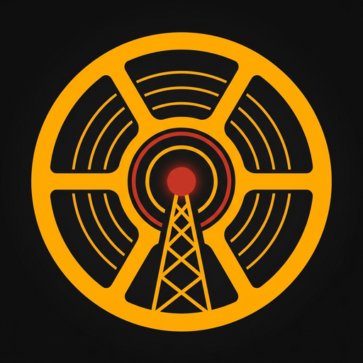

<p align="center">
  
</p>

# Archive Signal

> **Every recording has a history. Archive Signal keeps it alive.**  
> *Preserving the signals that shaped 1980s & 1990s music history.*

[](https://github.com/JupiterIsland/archive-signal/actions/workflows/ci.yml)
[](catalog/archives.json)
[](LICENSE)

**Archive Signal** is a digital preservation museum dedicated to preserving and documenting rare **1980s and 1990s** music broadcasts, television appearances, radio recordings, documentaries, interviews, live performances, and cultural media before they disappear.

Every year, recordings are lost through rights changes, platform closures, ageing physical media, and forgotten collections.

Archive Signal exists to ensure these stories remain discoverable.

---

## Why Archive Signal?

Music history is more than albums.

Some of the most important moments in music culture exist in:

* Radio broadcasts
* Television appearances
* Documentaries
* Interviews
* Concert recordings
* Promotional films
* Independent productions
* Home-recorded broadcasts
* Archive tape collections

Many survive only because somebody pressed record.

Archive Signal helps preserve those recordings, document their history, and provide the context that gives them meaning.

---

## What Makes Archive Signal Different?

Archive Signal is not simply a media catalogue.  
**Every archive entry is treated as a historical record and museum exhibit.**

Instead of *"Here's a VHS transfer"*, Archive Signal shows **"Here's why this recording matters."**

Each item captures:

* **Original source** & broadcast origin
* **Original format** (Betamax, S-VHS, U-Matic, Chrome Cassette, DAT, Open-Reel, DigiBeta)
* **Transfer chain** & capture hardware
* **Technical metadata** & checksum integrity records
* **Restoration history** & preservation notes
* **Historical context** & cultural significance
* **Related recordings** & cross-linked broadcasts
* **Community discussion** & eyewitness preservation notes

The goal is to preserve both the media and the story behind it.

---

## Archive Categories

### Television Broadcasts
Historic television appearances, music specials, and cultural programming.
* Music performances · Festival broadcasts · Documentary features · Television interviews

### Radio Archives
Rare radio recordings and specialist programming.
* BBC sessions · Artist interviews · Broadcast specials · Live recordings

### Documentary Archives
Music documentaries and cultural films that provide historical context.
* Artist retrospectives · Scene documentaries · Regional music history · Production features

### Live Performance Archives
Significant live recordings and preserved broadcasts.
* Festival appearances · Concert recordings · Session performances · Special events

### Interview Archives
Conversations that capture the thoughts, opinions, and creative processes of artists and contributors.
* Press interviews · Radio discussions · Television features · Archival recordings

---

## Preservation Standards

Archive Signal places a strong emphasis on provenance and preservation. Where available, entries include:

| Pillar | Documented Fields |
| :--- | :--- |
| **Source Information** | Original format · Broadcast source · Recording origin · Archive references |
| **Transfer Information** | Capture hardware · Transfer methods · Digitisation notes · Quality assessments |
| **Preservation Information** | Restoration notes · Version history · Archive integrity records · SHA-256 Checksum verification |

### Archive Entry Structure

Every exhibit in [`catalog/archives.json`](catalog/archives.json) follows a consistent museum structure (verified automatically by [`tools/validate_catalog.py`](tools/validate_catalog.py)):

```text
Title
 ↓
Date
 ↓
Category
 ↓
Source & Original Format
 ↓
Transfer Chain
 ↓
Technical Metadata & Checksum
 ↓
Restoration Notes
 ↓
Historical Context ("Why This Recording Matters")
 ↓
Related Media
 ↓
References & Community Discussion
```

---

## Built Into v0.1 — The Digital Museum

* **Interactive Broadcast Museum Web App ([`index.html`](index.html)):**
  * Styled in authentic vintage broadcast tones: **Archive Black (`#111111`)**, **Signal Amber (`#FFB000`)**, and **Restoration Red (`#D43D2C`)**.
  * Instant search, **1980s / 1990s** decade switcher, and **5 official Archive Category** filters.
  * **Story-First Museum Dossier:** Inspect full provenance, transfer deck chains, SHA-256 integrity checksums, cross-linked related media, and add local **Community Preservation Notes**.
  * **In-Browser Archivist Intake (`+ Catalog Recording` + `Export JSON`):** Add new 80s/90s recordings and export schema-valid catalog JSON ready for pull requests.
* **Curated 1980s & 1990s Starter Catalog ([`catalog/archives.json`](catalog/archives.json)):**
  * 8 foundational UK & regional cultural broadcast exhibits spanning `1982–1999`.
* **Automated Schema Validation CI ([`tools/validate_catalog.py`](tools/validate_catalog.py)):**
  * GitHub Actions checks every catalog commit for unique IDs, valid categories, date formatting, and complete preservation provenance.

### Preview Locally

```bash
git clone https://github.com/JupiterIsland/archive-signal.git
cd archive-signal
python3 -m http.server 8090
```

Open **[http://127.0.0.1:8090](http://127.0.0.1:8090)** in your browser.

### Publish Live via GitHub Pages (10 Seconds)

1. Open **Settings → Pages** in your GitHub repository.
2. Under **Source**, choose **Deploy from a branch** → **`main`** / **`/ (root)`** → **Save**.
3. Your live **Archive Signal** digital museum goes live immediately at `https://jupiterisland.github.io/archive-signal/`.

---

## Vision & Long-Term Mission

Archive Signal is built around a simple belief:

> **Every recording has a history.**

A television appearance is more than a video file.  
A radio recording is more than an audio capture.  
Each archive item represents a moment in cultural history that deserves preservation, documentation, and context.

**Long-Term Mission:**
* Preserve rare 1980s & 1990s recordings before physical media disappears
* Document exact hardware transfer provenance & integrity checksums
* Encourage responsible, story-first archiving
* Support historical research and celebrate music culture
* Connect fragile recordings with the human stories attached to them

---

## Founder

Created by **Richard John Murray** (`JupiterIsland`).

Archive Signal was created from a lifelong interest in music history, broadcast culture, and the recordings that risk being forgotten. It combines decades of independent music archiving with a commitment to ensuring that culturally significant recordings remain discoverable for future generations.

> *Preservation is not just about saving media. It's about preserving the stories attached to it.*

---

## The Jupiter Island Portfolio

Archive Signal forms part of a wider independent portfolio:

* **[MemoryOS // Jupiter Studio](https://github.com/JupiterIsland/memoryos)** — An AI Workstation for intelligent model routing, project context, and live telemetry.
* **[RIFFDNA™](https://github.com/JupiterIsland/riffdna)** — A player-adaptive tone system that learns how musicians play and automatically evolves tone in real time.
* **[Archive Signal](https://github.com/JupiterIsland/archive-signal)** — A digital preservation platform focused on music history, broadcasts, and cultural archives.

Together, these projects reflect a shared mission:

> **Building tools for intelligence, creativity and preservation.**

---

## License

Licensed under the MIT License. See [LICENSE](LICENSE) for details.
